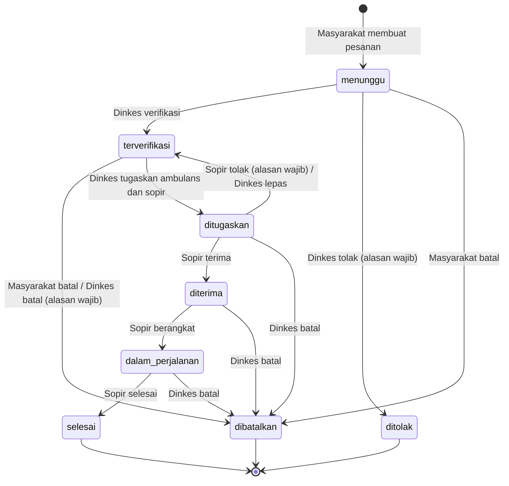

# Alur status pesanan

Sumber: `docs/RANCANGAN_ALUR.md` §5, diterapkan oleh `App\Services\PesananWorkflow` dan `PesananStatus::transisiTerbuka()`.

| Dari | Ke | Aktor | Tes |
|---|---|---|---|
| — | `menunggu` | Masyarakat | `PesananWorkflowTest::test_buat_membuat_kode_status_menunggu_dan_log` |
| `menunggu` | `terverifikasi` | Dinkes | `test_verifikasi_mengisi_pelaku_dan_waktu` |
| `menunggu` | `ditolak` | Dinkes | `test_tolak_wajib_alasan_dan_tersimpan` |
| `menunggu`, `terverifikasi` | `dibatalkan` | Masyarakat | `test_warga_membatalkan_dari_menunggu_dan_terverifikasi` |
| `terverifikasi` | `ditugaskan` | Dinkes | `test_tugaskan_mengisi_sumber_daya_dan_ambulans_bertugas` |
| `ditugaskan` | `diterima` | Sopir | `test_sopir_menerima_penugasan` |
| `ditugaskan` | `terverifikasi` | Sopir / Dinkes | `test_sopir_menolak_mengembalikan_ke_terverifikasi_dan_membebaskan_sumber_daya`, `test_admin_melepas_penugasan` |
| `diterima` | `dalam_perjalanan` | Sopir | `test_mulai_perjalanan_dan_selesai_harus_berurutan` |
| `dalam_perjalanan` | `selesai` | Sopir | `test_alur_penuh_sampai_selesai_dan_ambulans_kembali_tersedia` |
| aktif (kecuali `menunggu`) | `dibatalkan` | Dinkes | `test_admin_membatalkan_dengan_alasan_dan_membebaskan_ambulans` |

Status yang memegang ambulans dan sopir: `ditugaskan`, `diterima`, `dalam_perjalanan`. Status final: `selesai`, `ditolak`, `dibatalkan`.
