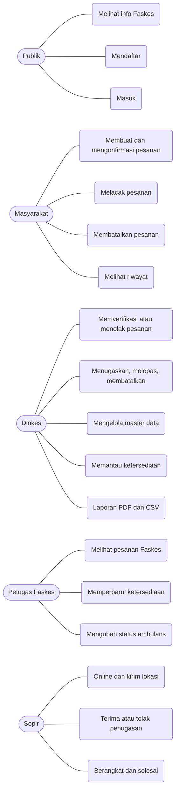

# Use case

| Use case | Aktor | Prasyarat | Hasil | Kebutuhan |
|---|---|---|---|---|
| Membuat dan mengonfirmasi pesanan | Masyarakat | Masuk sebagai Masyarakat | Pesanan `menunggu` dengan kode `SGP-…` | FR-06, FR-07 |
| Melacak pesanan | Masyarakat | Pemilik pesanan | Linimasa dan posisi sopir | FR-08 |
| Membatalkan pesanan | Masyarakat | Status `menunggu`/`terverifikasi` | `dibatalkan` | FR-09 |
| Memverifikasi atau menolak | Dinkes | Status `menunggu` | `terverifikasi` / `ditolak` | FR-11, FR-12 |
| Menugaskan | Dinkes | Status `terverifikasi`, ambulans tersedia, sopir online dari Faskes sama | `ditugaskan` | FR-13 |
| Melepas atau membatalkan | Dinkes | Status memegang sumber daya | `terverifikasi` / `dibatalkan` | FR-14 |
| Mengelola master | Dinkes | — | Data Faskes/Ambulans/Sopir/Petugas | FR-15 |
| Memperbarui ketersediaan | Petugas Faskes | Terhubung ke Faskes | Angka dan stempel waktu baru | FR-19 |
| Menerima atau menolak penugasan | Sopir | Status `ditugaskan` kepadanya | `diterima` / `terverifikasi` | FR-23 |
| Berangkat dan selesai | Sopir | Status `diterima` / `dalam_perjalanan` | `dalam_perjalanan` / `selesai` | FR-23 |
